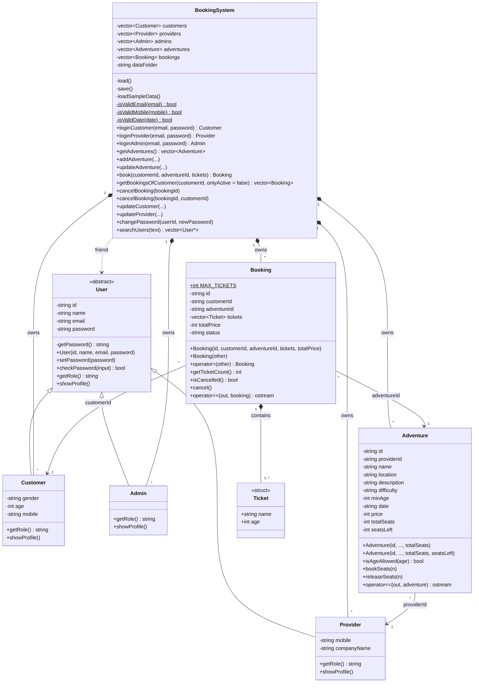
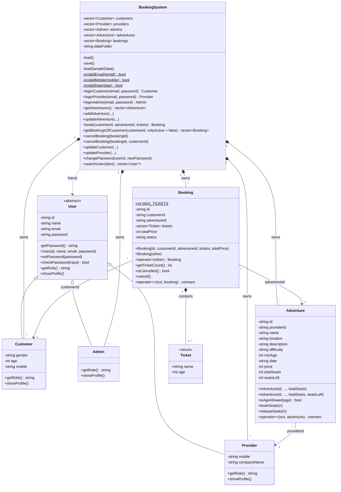

# Class diagram

All classes in `src/` and how they connect. Plain getters and setters are left out
to keep the diagram readable.

The picture above is made from the Mermaid code below. If you change the code, the picture must be made again.

**How to read it**
- `-` is private, `+` is public.
- *Italic* functions are pure virtual (`= 0`): each child class must write its own.
- Underlined members are `static`: one for the whole class, not one per object.
- Empty triangle arrow = inheritance: Customer, Provider and Admin are a `User`.
- Filled diamond = composition: the owner holds the objects (`BookingSystem` holds all
  users, adventures and bookings; a `Booking` holds its `Ticket`s).
- Plain arrow = a link by ID: a `Booking` stores its customer's ID and its adventure's ID,
  and an `Adventure` stores its provider's ID.
- Dashed arrow «friend» = `BookingSystem` is a friend class of `User`, so it can call the
  private `getPassword()` to save the password in the data file.
- `operator<<` is a friend function, not a member; it is listed in the class it prints.
- Two lines with the same name (the `Adventure` constructors, `cancelBooking`) are
  overloaded functions.
- `customer.cpp`, `provider.cpp` and `admin.cpp` are not classes. They show the menus and
  call `BookingSystem` functions.
