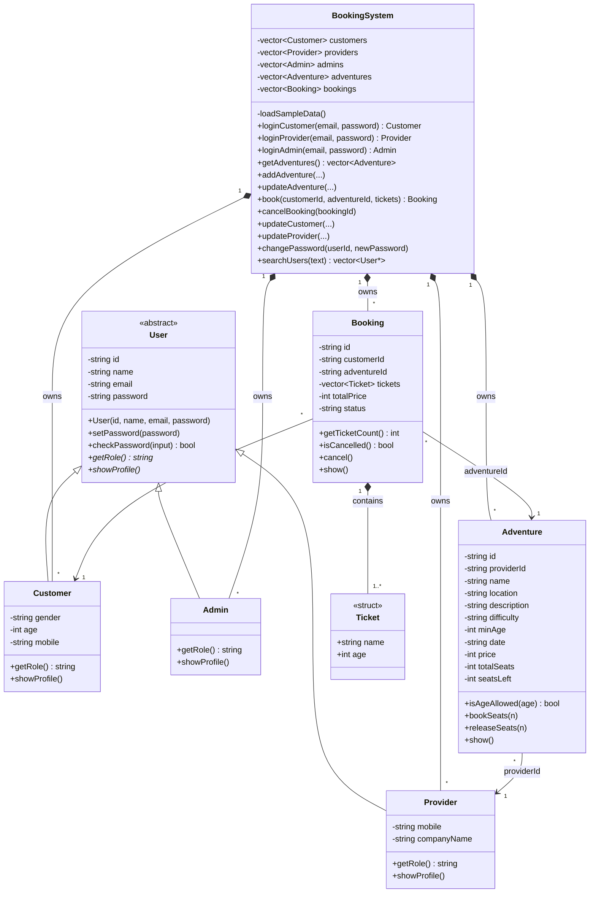

# Class diagram

All classes in `src/` and how they connect. Plain getters and setters are left out
to keep the diagram readable.

**How to read it**
- `-` is private, `+` is public.
- *Italic* functions are pure virtual (`= 0`): each child class must write its own.
- Empty triangle arrow = inheritance: Customer, Provider and Admin are a `User`.
- Filled diamond = composition: the owner holds the objects (`BookingSystem` holds all
  users, adventures and bookings; a `Booking` holds its `Ticket`s).
- Plain arrow = a link by ID: a `Booking` stores its customer's ID and its adventure's ID,
  and an `Adventure` stores its provider's ID.
- `customer.cpp`, `provider.cpp` and `admin.cpp` are not classes. They show the menus and
  call `BookingSystem` functions.
