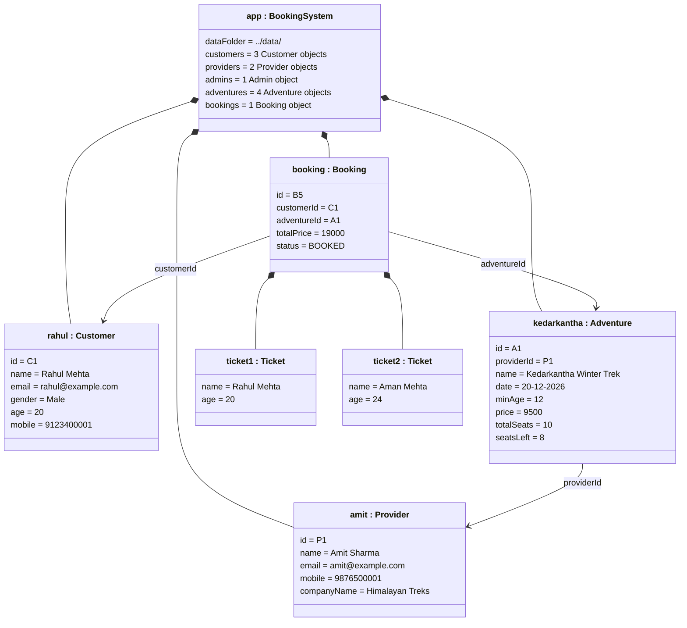

# Object diagram

The objects in memory right after a program reads the sample data: the booking made by
Rahul for the Kedarkantha trek, and the objects linked to it.
Each box is one object, written as `objectName : ClassName`, with the values of its data.
(Only the objects in this one booking are shown; the rest of the sample data is left out.)

The picture above is made from the Mermaid code below. If you change the code, the picture must be made again.

**How to read it**
- `seatsLeft = 8`: the trek has 10 seats and this booking took 2 (one per ticket).
- `totalPrice = 19000`: 2 tickets × Rs. 9500.
- The booking does not store the customer or adventure object itself, only their IDs
  (`C1`, `A1`). The arrows show which object each ID points to.
- Filled diamond = the object on the diamond side holds the other one inside it.
