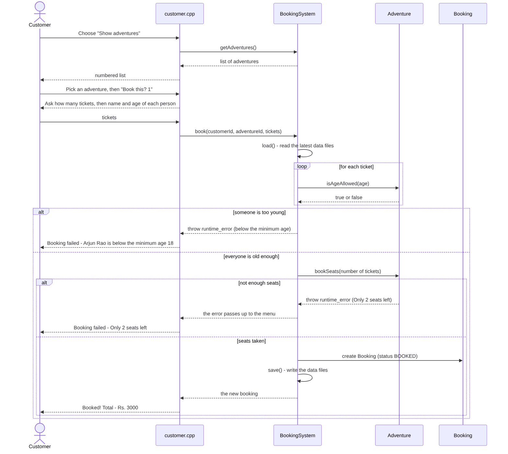
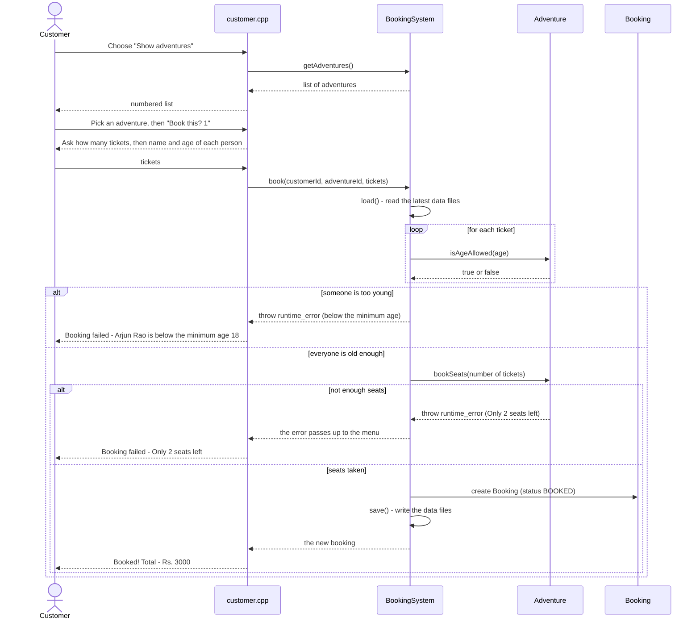

# Sequence diagram: booking an adventure

What happens, step by step, when a customer books an adventure in `customer.cpp`.
Time goes from top to bottom.

The picture above is made from the Mermaid code below. If you change the code, the picture must be made again.

**How to read it**
- Solid arrow = a function call. Dashed arrow = the answer coming back.
- `loop` = repeated for each ticket.
- `alt` / `else` = only one of the boxes happens, depending on the condition.
- `load()` and `save()` are how the three programs share data: the booking is in the
  files right away, so the provider and admin programs see it.
- The two errors are `runtime_error`s thrown by `BookingSystem` and `Adventure`,
  and caught by the `try` / `catch` in `bookScreen()` in `customer.cpp`.
