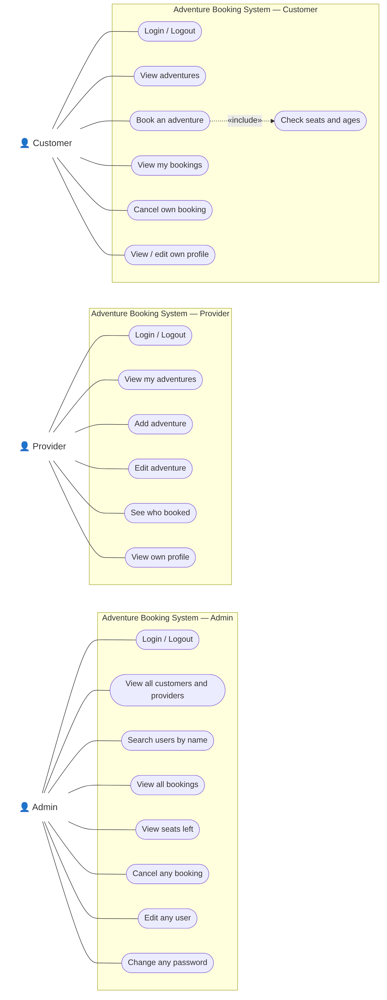
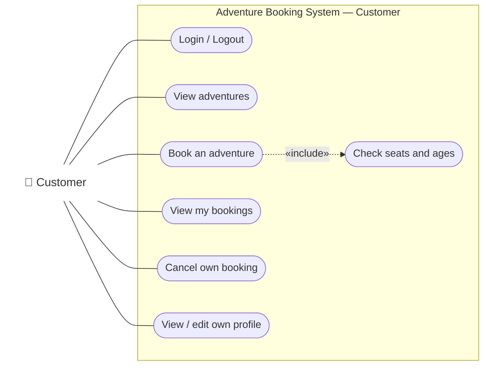
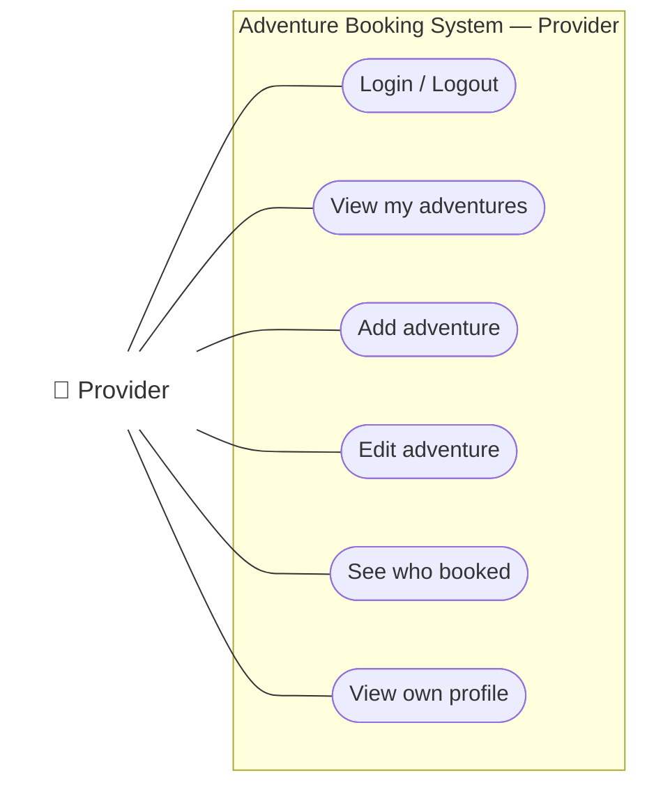
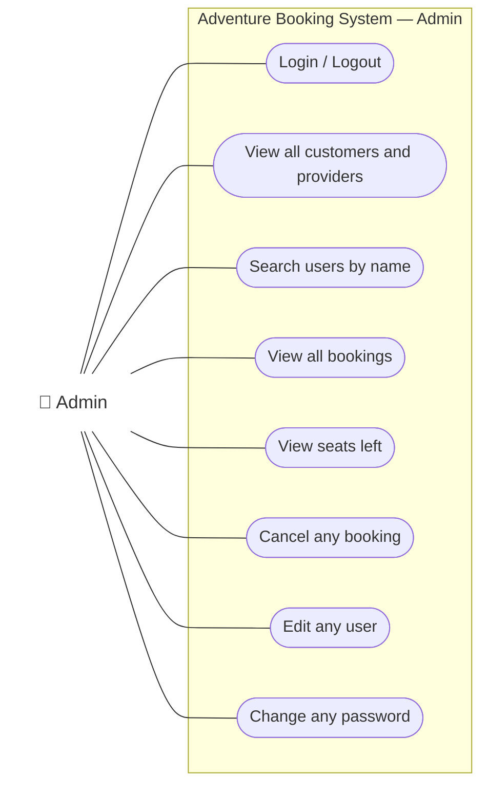

# Use case diagram

Who can do what. Each actor uses its own program (`customer.cpp`, `provider.cpp`, `admin.cpp`).
The box is the system; each rounded box is one use case. The diagram is drawn in three
parts, one per actor, so that no lines cross.

The picture above is made from the Mermaid code below. If you change the code, the picture must be made again.

## Customer

## Provider

## Admin

**How to read it**
- A plain line means the actor can use that use case.
- `«include»` means "Book an adventure" always runs "Check seats and ages" as part of it.
- All three parts are the same system: the three programs share the same data files.
