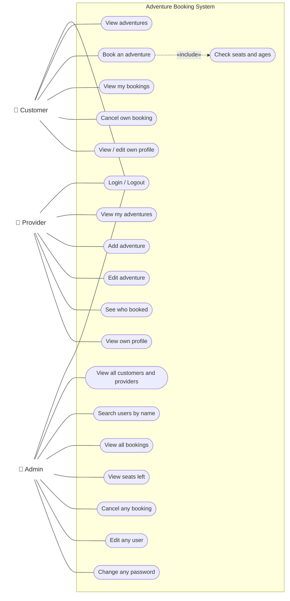

# Use case diagram

Who can do what. Each actor uses its own program (`customer.cpp`, `provider.cpp`, `admin.cpp`).
The big box is the system; each rounded box is one use case.

**How to read it**
- A plain line means the actor can use that use case.
- `«include»` means "Book an adventure" always runs "Check seats and ages" as part of it.
